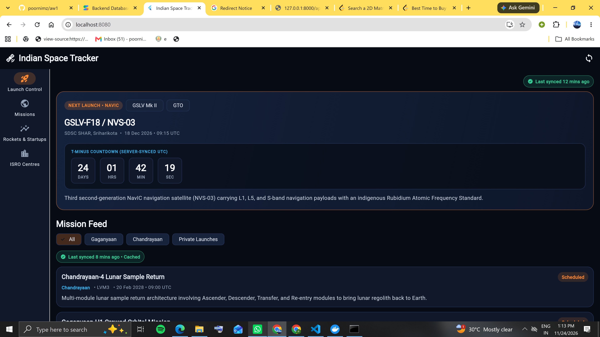

# Indian Space Mission & Startup Tracker

A full-stack telemetry and ecosystem tracker for ISRO missions, Gaganyaan milestones, Indian launch vehicles, ISRO centres, and NewSpace startups.

## Tech Stack
- **Backend (`backend/`):** FastAPI, SQLAlchemy 2.0, PostgreSQL 16, Redis 7 (10-minute response cache with graceful degradation), RQ worker, and an idempotent ingestion pipeline with offline `seed_data.json` fallback.
- **Frontend (`frontend/`):** Cross-platform Flutter (Riverpod, Dio, fl_chart, shimmer) targeting both **Flutter Web** and **Android Release APK**.

---

## Project Structure

```text
indian-space-tracker/
├── backend/
│   ├── app/
│   │   ├── api/v1/endpoints/   # missions, vehicles, startups, centres, admin
│   │   ├── core/               # config, database, redis_client
│   │   ├── models/             # SQLAlchemy ORM tables
│   │   ├── schemas/            # Pydantic v2 response schemas
│   │   ├── services/           # ingestion.py & seed_data.json
│   │   ├── workers/            # RQ sync task
│   │   └── main.py             # FastAPI app, CORS, RFC 7807 error handlers
│   ├── tests/test_api.py       # Pytest suite
│   ├── docker-compose.yml      # PostgreSQL 16 + Redis 7
│   └── requirements.txt
└── frontend/
    ├── android/                # Android manifest & permissions
    ├── lib/
    │   ├── core/               # AppConfig, Dio ApiClient, AppTheme
    │   ├── models/             # Dart data models
    │   ├── providers/          # Riverpod providers & filters
    │   ├── screens/            # Shell, Launch Control, Missions, Rockets & Startups, Centres
    │   ├── widgets/            # CountdownCard, PayloadComparisonChart, state views
    │   └── main.dart
    ├── test/widget_test.dart
    ├── pubspec.yaml
    └── vercel.json

    cd backend
.\venv\Scripts\Activate.ps1
pip install -r requirements.txt

# Start PostgreSQL 16 and Redis 7
docker compose up -d

# Populate initial ISRO & startup seed data
python -m app.services.ingestion --seed

# Run backend tests
python -m pytest -v

# Start FastAPI server
python -m uvicorn app.main:app --reload --host 0.0.0.0 --port 8000

cd frontend
flutter pub get
flutter analyze
flutter test

cd frontend
flutter build web --release

cd build\web
python -m http.server 8080

Open http://localhost:8080 in your browser while Terminal 1 (uvicorn) is running.
(For hot-reload development, run flutter run -d chrome from frontend\.)

For Android Emulator (uses default http://10.0.2.2:8000/api/v1):
Powershell command:
cd frontend
flutter build apk --release

For Physical Android Phone on the same Wi-Fi (replace <YOUR_PC_IP> with your ipconfig IPv4 address):

cd frontend
flutter build apk --release --dart-define=API_BASE_URL=http://<YOUR_PC_IP>:8000/api/v1

Output APK path:
frontend\build\app\outputs\flutter-apk\app-release.apk

## Screenshots

### Web App (`localhost:8080`)

